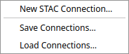
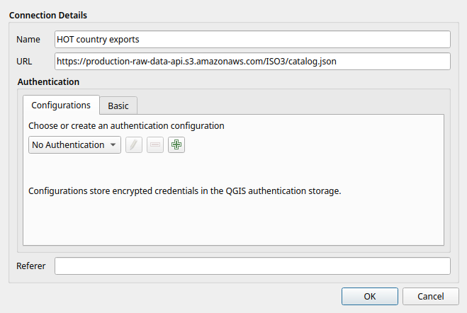
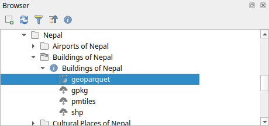
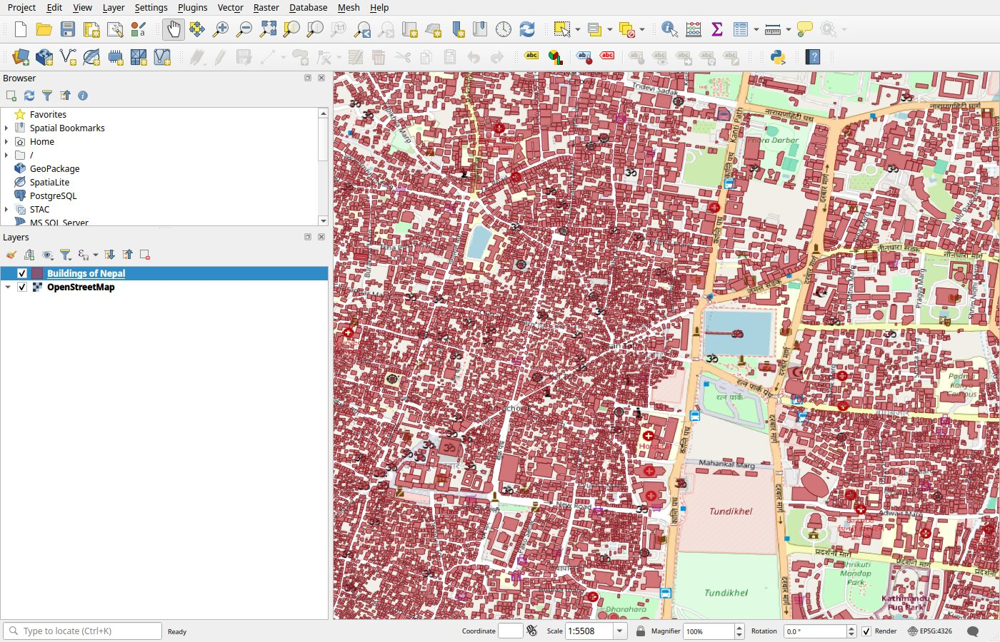
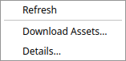
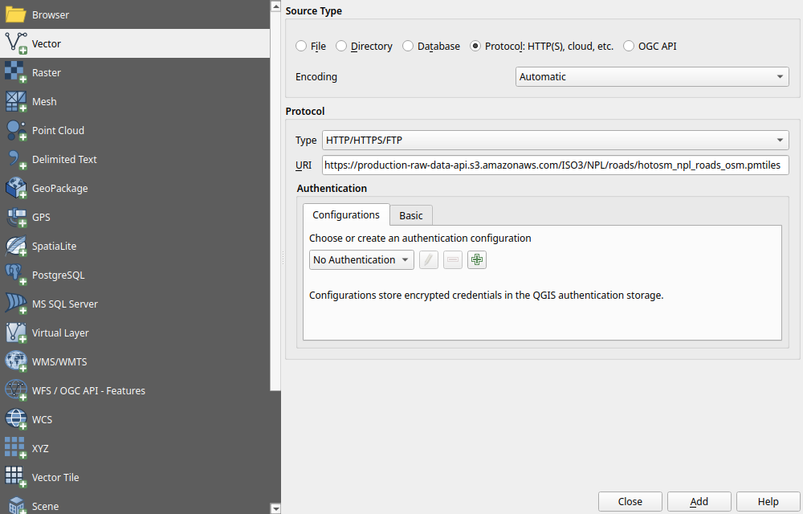

# Use the data in QGIS

QGIS reads the STAC catalog directly, so you can browse every country and layer from the
Browser panel and load a layer without downloading the whole file first. The screenshots
below are from QGIS 4.2.

| QGIS version | What works |
| --- | --- |
| 3.40 and later | Browse the catalog from the Browser panel. |
| 4.0 and later | Drag a layer's GeoParquet asset from the catalog onto the map ([added in 4.0](https://github.com/qgis/QGIS/commit/3f59bf3b93)). |
| Any version with GDAL 3.8 or later | Add a GeoParquet or PMTiles file by its URL, as shown in [Add a file by its URL](#add-a-file-by-its-url). |

## Connect to the catalog

1. In the **Browser** panel, right-click **STAC** and choose **New STAC Connection…**

    

2. Enter a name, such as `HOT country exports`, and this URL:

    ```text
    https://production-raw-data-api.s3.amazonaws.com/ISO3/catalog.json
    ```

    Leave authentication as **No Authentication** and click **OK**.

    

The connection is saved in your QGIS profile, so you only add it once.

## Browse to a layer

Expand **STAC**, then **HOT country exports**. The countries are listed by name. Expand a
country to see its layers, then expand a layer to reach its item. The item lists its
assets, one per file format.



## Load a layer

Drag the **geoparquet** asset onto the map. A layer holds points, lines and polygons
together, so QGIS first reads the file to split it by geometry type and asks which to add.
That takes seconds for most layers.



!!! tip "Large layers: add one geometry type"
    For a country's buildings or roads, reading the whole file can take many minutes. Add
    the layer by its URL as in [Add a file by its URL](#add-a-file-by-its-url), with the
    geometry type you need on the end, and QGIS loads it straight away:

    ```text
    https://production-raw-data-api.s3.amazonaws.com/ISO3/NPL/_layers/osm/buildings.parquet|geometrytype=Polygon
    ```

    Use `Point`, `LineString` or `Polygon`. Zoom to the area you need, since QGIS draws
    every feature in view.

The other assets cannot be dragged onto the map. Right-click the
item and choose **Download Assets…** to save them, or **Details…** to see every asset and
its URL.



## Add a file by its URL

Any GeoParquet or PMTiles file in the catalog can also be added by its URL. This works
without a STAC connection and in QGIS versions that cannot drag assets.

1. Open **Layer › Add Layer › Add Vector Layer…**.
2. Under **Source Type**, choose **Protocol: HTTP(S), cloud, etc.**
3. Set **Type** to **HTTP/HTTPS/FTP** and paste the file's URL into **URI**. Copy the URL
   from the item's **Details…** in QGIS, or from the item page in STAC Browser.
4. Click **Add**.



For example, the roads of Nepal as PMTiles:

```text
https://production-raw-data-api.s3.amazonaws.com/ISO3/NPL/roads/hotosm_npl_roads_osm.pmtiles
```

GeoParquet holds the full data with every attribute. PMTiles holds tiles simplified for
display, so use it for viewing and GeoParquet for analysis. GDAL reads
[PMTiles](https://gdal.org/en/stable/drivers/vector/pmtiles.html) from 3.8 and
[GeoParquet](https://gdal.org/en/stable/drivers/vector/parquet.html) from 3.5, when built
with Arrow.

## Work with one area only

To keep only part of a country, for example one district, cut it out before loading it.
[DuckDB](duckdb.md) or [ogr2ogr](other-tools.md#gdal-and-ogr2ogr) can write that area to
a GeoPackage, which you then open in QGIS like any other file.
